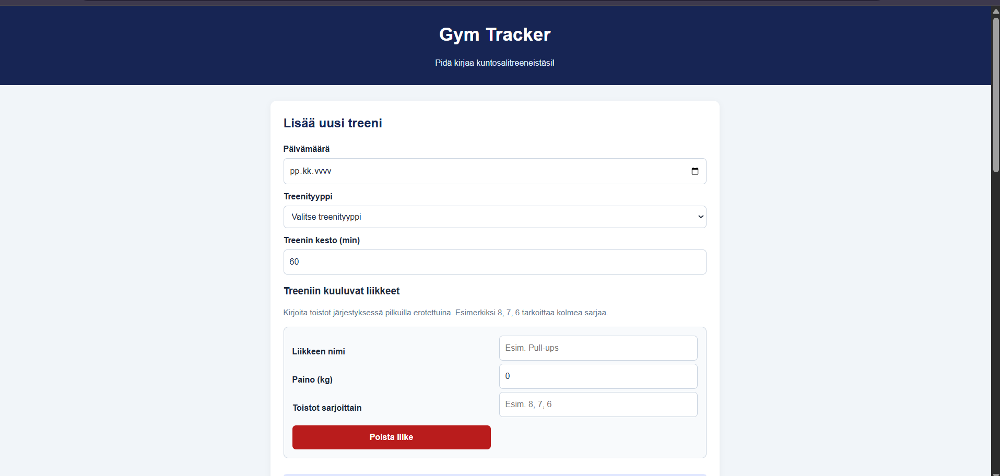
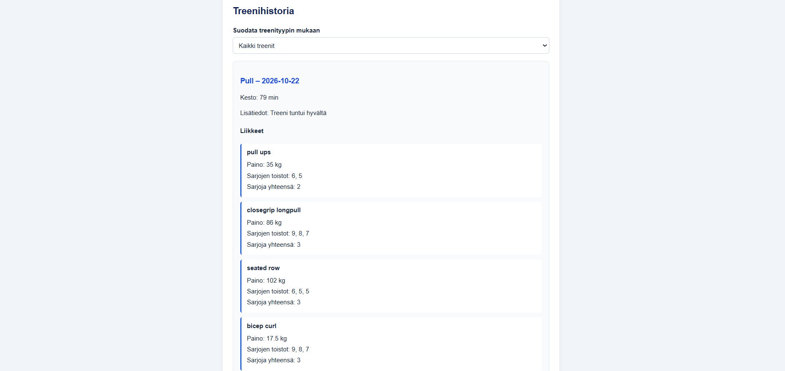

# Gym Tracker – Kuntosalipäiväkirja

Tekijä: Amir Ahmed

## Projektisuunnitelma

### Projektin idea

Gym Tracker on verkkosovellus kuntosaliharjoittelun kirjaamiseen. Sovellus on tarkoitettu kuntosalilla käyville ihmisille, jotka haluavat seurata omia treenejään ja harjoittelunsa kehitystä.

Sovelluksella voi tallentaa treenin päivämäärän, treenityypin, keston ja kaikki treeniin kuuluvat liikkeet. Jokaiselle liikkeelle voi kirjata painon sekä jokaisen sarjan toistot erikseen.

### Suunnitellut toiminnot

- Käyttäjä voi lisätä uuden treenin ja valita treenityypin tai kirjoittaa oman treenityypin.
- Käyttäjä voi lisätä yhteen treeniin useita liikkeitä.
- Jokaiselle liikkeelle voi tallentaa painon, sarjojen määrän ja jokaisen sarjan toistot.
- Käyttäjä voi tarkastella treenihistoriaa ja suodattaa treenejä treenityypin mukaan.
- Käyttäjä voi poistaa tallennettuja treenejä.
- Sovellus näyttää treenien kokonaismäärän ja treeneihin käytetyn kokonaisajan.
- Treenit tallennetaan selaimen localStorage-muistiin, jotta ne säilyvät sivun päivittämisen jälkeen.

### Rautalankamalli / luonnos

Tässä osiossa esitellään sovelluksen suunniteltu ulkoasu. Rautalankamallissa näkyvät treenin lisäyslomake, liikkeiden lisääminen, treenitilastot ja treenihistoria.

+------------------------------+
| Kuntosalipäiväkirja          |
+------------------------------+
| LISÄÄ TREENI                 |
| Päivämäärä: [___________]    |
| Treenityyppi: [__________ v] |
| Kesto: [____] min            |
|                              |
| LIIKKEET                     |
| Liikkeen nimi: [__________]  |
| Paino: [___] kg              |
| Toistot: [8, 7, 6]           |
| [+ Lisää liike]              |
| [Tallenna treeni]            |
+------------------------------+
| TREENIHISTORIA               |
| Suodatus: [Kaikki treenit v] |
| Tallennetut treenit [Poista] |
+------------------------------+
| TILASTOT                     |
| Treenit: [0]                 |
| Treeniminuutit: [0]          |
+------------------------------+
      

## Verkkolinkit

- **Julkaistu sovellus:** [Lisää GitHub Pages -linkki tähän](https://yourusername.github.io/your-repository/)
- **GitHub-repositorio:** [Lisää oman repositoriosi linkki tähän](https://github.com/yourusername/your-repository)
- **Projektin videoesittely:** [Lisää videoesittelyn linkki tähän](https://example.com/)

## Tietoja sovelluksesta

Gym Tracker on verkkosovellus, jonka avulla käyttäjä voi pitää kirjaa kuntosaliharjoittelustaan.

Käyttäjä voi luoda treenin, valita treenityypin ja lisätä siihen useita liikkeitä. Jokaiselle liikkeelle tallennetaan käytetty paino ja sarjojen toistot. Esimerkiksi liikkeelle Pull-ups voi tallentaa kolme sarjaa toistoilla 8, 7 ja 6.

Sovelluksessa voi tarkastella aiempia treenejä, suodattaa niitä treenityypin perusteella ja poistaa treenejä. Tiedot tallennetaan selaimen localStorageen.

## Teknologiat

- **HTML** – verkkosivun rakenne, lomakkeet ja sisältö.
- **CSS** – ulkoasu, värit, asettelu ja responsiivisuus.
- **JavaScript** – sovelluksen toiminnallisuus, tapahtumankäsittely ja tietojen käsittely.
- **DOM-skriptaus** – lomake-elementtien hakeminen, uusien liikerivien luominen ja treenihistorian päivittäminen.
- **localStorage** – treenien tallentaminen selaimen muistiin.

## Sovelluksen käyttö

1. Avaa julkaistu sovellus verkkolinkistä.
2. Valitse treenin päivämäärä, treenityyppi ja kesto.
3. Jos valitset treenityypiksi Muu, kirjoita haluamasi treenityypin nimi.
4. Lisää ensimmäinen liike ja täytä sen nimi, paino ja sarjojen toistot.
5. Lisää tarvittaessa lisää liikkeitä painikkeella **Lisää liike**.
6. Kirjoita sarjojen toistot pilkuilla erotettuina. Esimerkiksi `8, 7, 6` tarkoittaa kolmea sarjaa.
7. Tallenna treeni.
8. Tarkastele treenihistoriaa, suodata treenejä tai poista treeni tarvittaessa.
9. Päivitä sivu ja tarkista, että tallennetut treenit säilyvät.

## Sovelluksen käynnistäminen paikallisesti

1. Kloonaa tai lataa GitHub-repositorio omalle koneellesi.
2. Avaa projektikansio esimerkiksi Visual Studio Codessa.
3. Varmista, että `index.html`, `script.js` ja `styles.css` ovat oikeissa paikoissa. Tässä versiossa kaikki kolme tiedostoa ovat samassa kansiossa.
4. Avaa `index.html` selaimessa tai käytä Visual Studio Coden Live Server -laajennusta.

## Kuvakaappaukset

Tähän lisätään kuvakaappaus toimivasta sovelluksesta. Kuvakaappauksessa voi näkyä treenin lisääminen ja tallennettu treeni, jossa on useita liikkeitä.

## Tunnetut virheet / puutteet

Sovellus tallentaa tiedot selaimen paikalliseen muistiin. Tiedot eivät siirry automaattisesti toiselle laitteelle tai toiseen selaimeen.

Sovelluksessa ei ole käyttäjätilejä, pilvitallennusta eikä treenien muokkaustoimintoa tallennuksen jälkeen. Tallennetun treenin voi poistaa, mutta sitä ei voi vielä muokata.

## Työn jakautuminen

Projekti on tehty yksilötyönä.

## Oma arvio ja oppimisen reflektointi

- **Missä onnistuin?** Onnistuin suunnittelemaan kuntosaliharjoitteluun sopivan sovelluksen mitä voin vaikkapa itse hyödyntää ja seurata kehitystä.

## AI:n käyttö

Hyödynsin ChatGPT:tä projektin suunnittelun ja toteutuksen tukena. Käytin tekoälyä apuna HTML-rakenteen ja CSS-tyylien selkeyttämisessä sekä JavaScriptin toimintojen suunnittelussa ja virheiden tarkistamisessa.

Tekoäly auttoi minua jäsentämään sivuston ulkoasua, tekemään lomakkeesta selkeämmän ja parantamaan sivun responsiivisuutta eri näyttöko’oille. Hyödynsin sitä myös README-tiedoston rakenteen ja dokumentoinnin tekemisessä.

Tarkistin ja testasin sovelluksen toimintaa itse. Projektin tavoitteena oli oppia HTML:n, CSS:n, JavaScriptin ja DOM-skriptauksen käyttöä käytännössä sekä ymmärtää, miten sovelluksen eri osat toimivat yhdessä. 