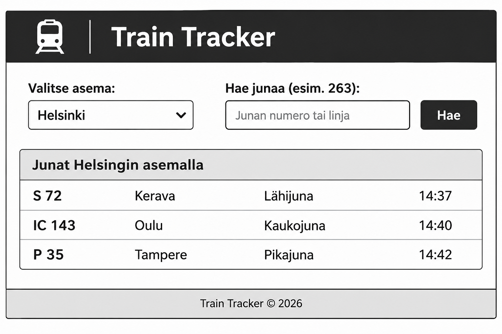
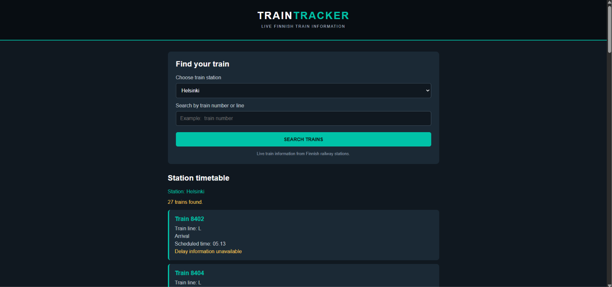

# Train Tracker

**Tekijä:** Amir Ahmed

## Projektisuunnitelma

### Projektin idea

Train Tracker on verkkosovellus, jonka avulla käyttäjä voi tarkastella junien reaaliaikaisia tietoja eri rautatieasemilla. Sovellus on tarkoitettu kaikille, jotka haluavat seurata junien kulkua ja tarkistaa junien aikatauluja sekä mahdollisia myöhästymisiä.

### Suunnitellut toiminnot

- Käyttäjä voi valita rautatieaseman pudotusvalikosta.
- Sovellus näyttää valitun aseman junien tietoja.
- Käyttäjä voi etsiä junia junan numeron tai lähijunatunnuksen perusteella.
- Sovellus näyttää junan numeron, tyypin, lähtö- ja saapumistiedot sekä mahdollisen myöhästymisen.

### Rautalankamalli / luonnos

## Verkkolinkit

- **Julkaistu sovellus:** https://OMA-KÄYTTÄJÄNIMI.github.io/train-tracker/
- **GitHub-repositorio:** https://github.com/OMA-KÄYTTÄJÄNIMI/train-tracker

## Tietoja sovelluksesta

**Train Tracker** on verkkosovellus, joka hakee junien reaaliaikaisia tietoja Digitrafficin avoimesta rajapinnasta.

Sovelluksessa voi valita neljä eri rautatieasemaa:

- Helsinki (HKI)
- Pasila (PSL)
- Tikkurila (TKL)
- Tampere (TPE)

Käyttäjä voi tarkastella valitun aseman junia ja etsiä tiettyä junaa numeron tai lähijunatunnuksen perusteella. Sovellus näyttää junien aikataulu- ja myöhästymistietoja.

## Teknologiat

- **HTML** – verkkosivun rakenteen luominen.
- **CSS** – sovelluksen ulkoasu, värit ja asettelu.
- **JavaScript** – sovelluksen toiminnallisuus, junien tietojen hakeminen rajapinnasta ja hakutoiminto.
- **Digitraffic Railway API** – junien reaaliaikaisten tietojen hakeminen.

## Sovelluksen käyttö

1. Avaa julkaistu sovellus yllä olevasta linkistä.
2. Valitse haluamasi rautatieasema pudotusvalikosta.
3. Sovellus näyttää valitun aseman junien tiedot.
4. Voit etsiä tiettyä junaa kirjoittamalla hakukenttään junan numeron tai lähijunatunnuksen.
5. Voit vaihtaa asemaa ja tarkastella muiden asemien junia.

## Sovelluksen käynnistäminen paikallisesti

1. Kloonaa tai lataa tämä repositorio omalle koneellesi.
2. Avaa projektikansio.
3. Avaa `index.html` selaimessa.
4. Sovellus hakee junien tiedot Digitrafficin rajapinnasta.

## Kuvakaappaukset

Alla on kuvakaappaus toimivasta sovelluksesta.

## Tunnetut virheet / puutteet

Sovelluksessa on tällä hetkellä valittavana neljä rautatieasemaa. Asemavalikoimaa voisi laajentaa tulevaisuudessa lisäämällä uusia asemia. Sovellus tarvitsee internetyhteyden, jotta se voi hakea junien tiedot Digitrafficin rajapinnasta.

## Työn jakautuminen

Tein projektin itsenäisesti.

## Oma arvio ja oppimisen reflektointi

- **Missä onnistuin?** Onnistuin tekemään toimivan sovelluksen, joka hakee junien tietoja rajapinnasta ja näyttää ne käyttäjälle selkeästi. Sain myös toteutettua sovellukselle yhtenäisen ulkoasun.
- **Mikä oli haastavaa?** Haastavinta oli rajapinnan käyttäminen ja junien tietojen käsittely JavaScriptillä.
- **Mitä parantaisin, jos aikaa olisi enemmän?** Lisäisin sovellukseen uusia asemia ja kehittäisin ulkoasua sekä hakutoimintoa.
- **Mitä opin?** Opin lisää HTML:n, CSS:n ja JavaScriptin käytöstä sekä siitä, miten ulkoista rajapintaa voidaan hyödyntää verkkosovelluksessa.
- **Mikä jäi epäselväksi tai mistä haluaisin oppia lisää?** Haluaisin oppia lisää rajapintojen käytöstä ja JavaScriptin monipuolisemmista ominaisuuksista.
- **Oma arvio projektista:** 8/10 pistettä.

## Lähteet ja kiitokset

- Digitraffic – rautatieliikenteen avoin data: https://www.digitraffic.fi/rautatieliikenne/
- Käytetty tekoälytyökalu: ChatGPT.
- **Miten työkalua käytettiin:** ChatGPT:tä hyödynnettiin sovelluksen ulkoasun suunnittelussa, koodin selkeyttämisessä, rautalankamallin suunnittelussa sekä README-dokumentaation laatimisessa.